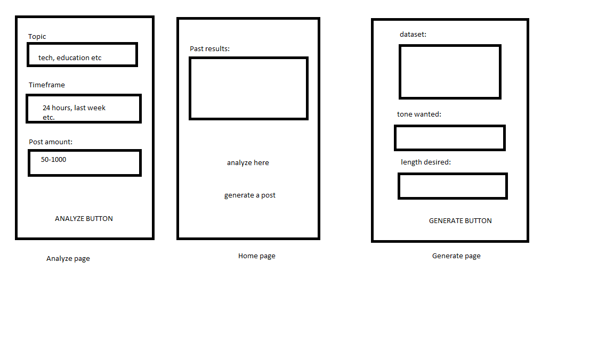
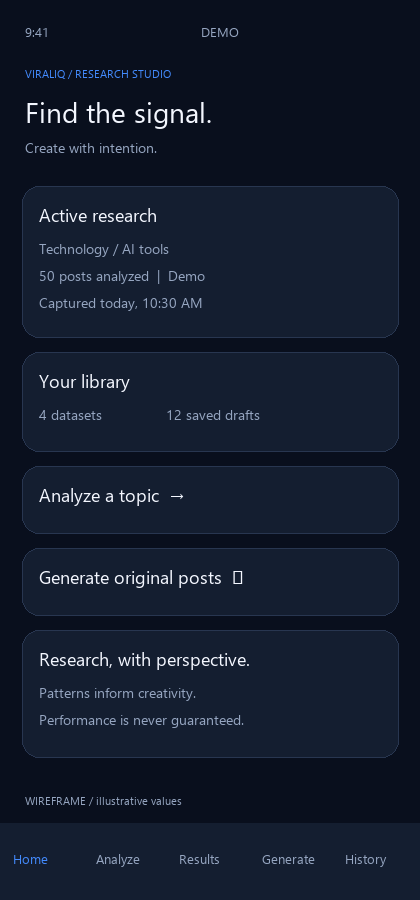
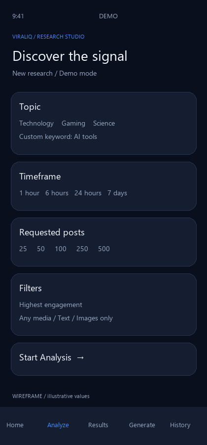
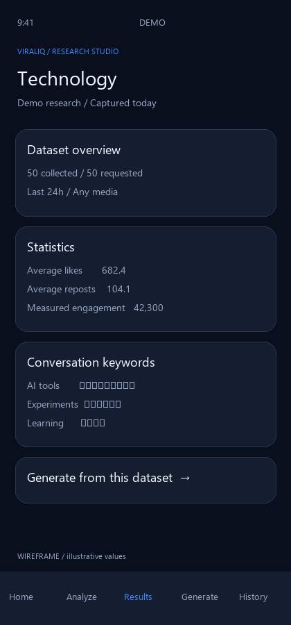
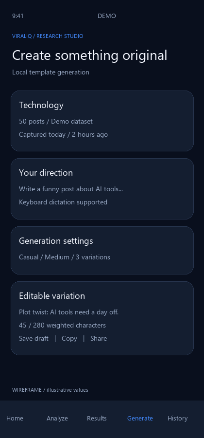
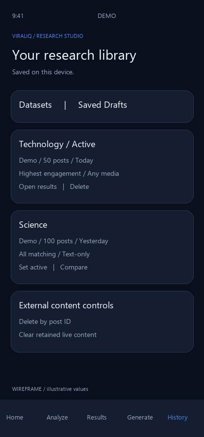

# Human written:

# Description

This app has the ability to analyze 100s of tweets from the popular platform X (formerly Twitter) and, using AI generation, bring that data together to make a 'most viral' generated tweet from said data.

There are different categories one could pick from as their data source, including tech, finance, gaming, etc. Options also include the time frame of the tweet analysis, any keywords the user wants, and the amount of posts to diagnose.

The app has two parts. It collects data on the tweet set, including likes, reposts, replies, tweet lenght, keywords, style of writing, and other patterns. It then uses this locally stored data in SQlite and gives it to the configured AI model, which generates the proposed tweets from this data. 

The ai here is pulling from an existing LLM, accessed through an API. This is not a locally trained AI model or an instance of an ai rather. Since the data is pulled from tweets and is hardly that big, it is more effecient to use a pre-existing LLM. 

The app does not 'train' or improve the ai over time it simlpy increases the data that it then hands off to the LLM. In future models I want to explore having a personal downloaded version such as Ollama to be trained on this functionality specifically.

# Wireframe



# Important note on X's data

Currently, it costs tokens to scan big swaths of tweets from X. In order to collect 1,000 posts, for example, it would be $5 in X API costs.

The second iteration will find a way around this, as I have found many Reddit posts and other sources where we can get real-time tweets without the API cost. For now, the app has a demo version where fake data is being tested to see if the generation works. This fake data is generated by an LLM. 

# Stored data types

This app stores research datasets from the tweet results that it collects, as well as a generated drafts history that the user generates. These are saved automatically. It also stores user preferences such as the dark/ light mode, selected criteria for the datasets and various other settings. 

# Device Functionality

When the user gets to the generation screen of tweets, they have the option to 'share' said text via the mobile device's share function, and it will pull up all of those options from X itself to Snapchat, Facebook, etc.

It also has a button to directly bring the generated tweet to X's editor, and will pull up X's app when the button is pressed.

# Human Interface Guidelines

The first implementation I did was a sentence case structure throughout the app. This makes everything uniform and concise when users are reading the various info across the app. Since this app is a little info-heavy in terms of the learning curve for the user, it is important for these small snippets to be easily read, and sentence case is the best for this.

I also ensured the buttons are more specific about what they accomplish. Noting the earlier point, there are quite a few steps here, so buttons can be a good headway on what is coming next. For example, the buttons "Saved drafts" and "Compare datasets" are both informative over something more dry. The buttons 'Drafts' or 'Compare' maybe could work here, but it's easy to get lost in this app, so this provides a better framework for user ease of use.

Third is an error message that appears if a user attempts to generate a tweet before analyzing any data. The error message will pop up stating, "Analyze a topic before generating a post." This is the helpful errors section in the guidelines. It isn't obvious that one can't just generate a post without having a localized dataset to go off of, and thus a more robust error message is useful in this scenario.


# The rest is written by AI I just keep it to reference things.

# ViralIQ

A React Native / Expo research studio for exploring public-post engagement, comparing saved research, and creating original X post drafts. Demo mode runs entirely on the phone without accounts, paid services, or API keys. Synthetic examples and local templates are explicitly labeled.

## Run

Requires Node.js 22.13+ (Node 24 recommended), npm, and a compatible Android/iOS Expo client.

```sh
npm ci
npm start
```

Scan the QR code with an Expo Go release supporting **SDK 58**, or use a development build. This project was initialized with the installed current Expo template, SDK 58 / React Native 0.88. Expo's SDK transition guidance may recommend SDK 57 for the store version of Expo Go; if your client reports an SDK mismatch, use an SDK 58 development build rather than mixing dependency versions. See [Expo setup](https://docs.expo.dev/get-started/create-a-project/).

```sh
npm run android
npm run ios
# Native development builds if needed (Android SDK / Xcode required)
npx expo run:android
npx expo run:ios
```

iOS builds require macOS. The supported assignment target is native Android/iOS. Browser/SQLite WASM hosting is not configured.

## Demonstrate the complete workflow

1. Launch in the default dark theme and **Demo** mode. With an empty library, Home's Generate button explains that research is required.
2. Open Analyze. Select Technology, last 24 hours, 50 posts, Highest engagement, Any media. Leave the keyword empty, or try `AI tools`. Start Analysis.
3. Results shows real calculations over synthetic samples. Inspect averages, medians, word/hashtag frequencies, opening phrases, length distribution and top examples. A smaller-than-requested sample is explicitly disclosed.
4. Generate from this dataset. Enter a direction, select tone/length/variation count, and generate **local templates (not AI)**. Edit, save, copy, or open the native Share Sheet. Your phone keyboard can dictate the direction. No microphone recording or camera permission is needed.
5. Save a second dataset with another timeframe/topic/media filter. In History, open Compare. Select A and B, examine absolute/percentage changes and confounder warnings. A zero baseline displays an undefined percentage rather than Infinity.
6. Set a historical dataset active. Home, Results and Generate share that selection. Restart the app to demonstrate persistence. Open Saved Drafts to edit and save an existing draft. Delete a dataset to demonstrate that associated drafts survive.
7. Switch to light mode from Home. Switch to Live to demonstrate a friendly configuration error; failed live requests never silently become demo data.

## Features and architecture

The application uses TypeScript, Expo Router bottom tabs, Expo SQLite, React Context, Expo Clipboard, React Native Share, and safe-area/keyboard handling. No automatic publishing or X login is implemented. Opening Share or X compose does not mean a post was published. Available share targets depend on installed applications and the OS.

```text
app/                     Home, Analyze, Results, Generate, History, Compare
src/types.ts             Shared models and filter types
src/analytics.ts         Pure statistics, filters, comparison and weighted counts
src/demo.ts              720 deterministic synthetic samples per topic
src/database.ts          Versioned schema, transactions, CRUD and retention
src/contexts.tsx         ThemeContext and DatasetContext
src/components.tsx       Shared cards, stats, selectors, inputs, bars and states
src/DraftEditor.tsx      Editing, persistence, clipboard and sharing
src/services.ts          Mobile research and generation adapters
server/                  Minimal secure-credential X / AI proxy
tests/                   Analytics and real SQLite schema regression tests
documentation/images/    Five generated wireframe PNGs
```

SQLite is the persistent source of truth. Schema version 1 is created transactionally using `PRAGMA user_version`; newer unsupported schemas are rejected. The four tables are `datasets`, `research_posts`, `drafts`, and `settings`. Typed domain objects are serialized into JSON payload columns, while relational IDs, foreign keys and content expiry are separate indexed columns. Queries bind parameters. Dataset deletion cascades source rows and sets draft references to NULL. Draft topic labels remain available after the dataset is deleted.

ThemeContext shares persistent theme colors. DatasetContext shares the active ID, its loaded dataset, the library and refresh/selection actions. Settings also persist the explicit Demo/Live choice. Database initialization failures show a retry action. Analytics are saved independently from third-party source text so draft generation uses stored summaries rather than sending the database to an AI model.

Demo samples span a rolling seven-day window, with denser samples in the last hour. Time, media, keyword and engagement filters actually execute; IDs are deduplicated before ranking. Repeated sample styles are intentional and may exaggerate recurring keywords. These samples are not real people or X posts. The rule-based generator inserts instructions as a brief, varies its opening and ending by tone, and uses research keywords in longer drafts; it does not semantically follow complex directions like an AI model.

## Optional live services

Copy the two examples separately:

```sh
cp .env.example .env
cp server/.env.example server/.env
npm run server
```

PowerShell equivalent: `Copy-Item .env.example .env` and `Copy-Item server/.env.example server/.env`.

Set the mobile `EXPO_PUBLIC_API_URL` to the backend URL, then restart Expo. For a physical device, use your computer's LAN address and set server `HOST=0.0.0.0` on a trusted network. Android emulator can use `http://10.0.2.2:3001`. The server defaults to loopback. HTTPS is required for remote deployment; put user authentication, appropriate network controls and production rate limiting in front of this minimal development proxy before exposing it publicly. It has bounded body size, per-IP throttling, request timeouts, and no persistent request logging or server content cache. It is not a production authentication system.

Keep `X_BEARER_TOKEN`, `AI_API_KEY`, `AI_MODEL`, and `AI_BASE_URL` **only in server/.env**. Never prefix secret values with `EXPO_PUBLIC_`. Secret env files are ignored by Git. Without credentials, Live displays an error and leaves user inputs/drafts intact. Optional AI-summary failure leaves statistics-based results usable.

The X adapter uses the [official recent-search endpoint](https://docs.x.com/x-api/posts/search-recent-posts), requests author/media expansions and supported public metrics, paginates a bounded candidate pool (default 500, maximum 2,000), then ranks locally. It searches a quoted topic/keyword phrase with supported media operators; it does not scrape or claim to retrieve the universally most viral posts. Recent search is limited to the rolling seven-day window and your actual access tier/quota. Missing metrics remain unavailable rather than being fabricated as zero for averages. Summed engagement includes only returned metrics. Rate-limit errors report retry information when available.

Hosted AI uses an OpenAI-compatible `/chat/completions` interface, with a provider base URL and model chosen by the operator. Only the selected dataset's topic, date, aggregate statistics, frequencies and the user's options are sent; source post text is not sent. JSON variation counts and practical weighted lengths are checked. No fine-tuning is performed. Local templates are available by explicitly selecting Demo. Both paths require human review and make no promises of virality.

## External content and privacy

Live source content is transient during analysis and is **not persisted by default** (`X_CONTENT_RETENTION_HOURS=0`). Aggregate analytical summaries remain. If the operator has the necessary permissions, a positive configured TTL retains source rows for at most 24 hours. Expired rows are purged on reads, app startup, and foreground resume; the app does not run deletion while closed. History supports removing a post ID across saved datasets, clearing all retained live content, and deleting datasets. Live Results displays source reference links rather than reproducing third-party text or approximating an official embedded-post display.

Retention limits alone are not a guarantee of compliance. Before any live deployment, review the current [X Developer Policy](https://docs.x.com/developer-terms/policy), approved use case, storage/display terms and deletion obligations. This assignment does not implement an automatic compliance-event ingestion service or synchronization of author deletions while offline. Keep content persistence disabled unless you implement the required operational deletion process. Analytical summaries are historical; removing a source row does not recalculate an old aggregate dataset.

## Wireframes

These are generated documentation wireframes with illustrative values, not screenshots of an emulator. Regenerate with `python documentation/generate_wireframes.py` (Pillow required).

| Home | Analyze | Results |
|---|---|---|
|  |  |  |

| Generate | History |
|---|---|
|  |  |

## Design principles

The interface applies Material Design's clear hierarchy through a quiet navy canvas, elevated cards, restrained blue actions, and consistent spacing. Large screen titles communicate location while compact metadata distinguishes capture dates, source and sample sizes. Bar charts use accompanying text labels so values remain understandable without relying on color alone. A light palette preserves the same semantic roles.

Following Human Interface Guidelines, the primary destinations stay in a persistent bottom tab bar. Research flows into results and then generation without hiding the current dataset's identity. Touch controls have a minimum height of 44–48 points, text inputs have accessibility labels, selections expose their state, safe areas protect content around device cutouts, and scrollable keyboard-aware forms keep editing practical on smaller phones.

Feedback is part of the workflow: busy states explain the current operation, empty screens show an actionable next step, explicit source labels distinguish demo data from live data, and destructive actions require confirmation. Sharing uses the native system sheet so users control the destination. The UI never equates opening that sheet with successful publication, and descriptive insights avoid suggesting guaranteed outcomes.

## Verification and limitations

```sh
npm run typecheck
npm test
npx expo install --check
npx expo export --platform android
```

Tests cover missing metrics, empty samples, median calculations, filters/deduplication, varying timeframes, zero denominators, comparison confounders, practical character weighting, and an actual file-backed SQLite database reopened across connections. Storage tests execute the same schema using Node SQLite, including content expiry, persisted settings and orphan-draft foreign-key behavior. Native Expo SQLite, screen interaction, process restarts and Share Sheet targets still need the device acceptance checklist in `documentation/ACCEPTANCE.md`.

The character counter weights links as 23 and approximates CJK/emoji weighting; it is not the complete X text parser. No separate audio transcription, photo attachments, direct posting, X OAuth, cloud sync or automatic compliance feed is implemented. No lint configuration is included; strict TypeScript and targeted tests are the configured checks. See `documentation/VERIFICATION.md` for results from the build environment.
